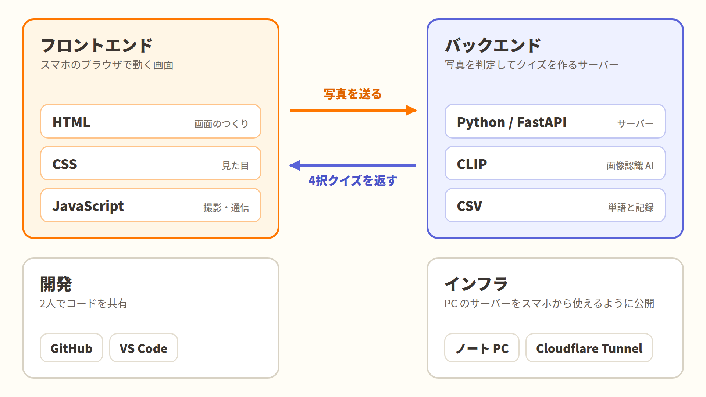

# パシャ単 📸

**身の回りの物を撮るだけで、英単語の4択クイズになる Web アプリ**

> 世界の全ては英単語に

<!-- スクリーンショットを docs/screenshot.png に置くと、ここに表示されます -->


- デモ動画：https://drive.google.com/file/d/1WKLrZisrIcT6pHGOTq3p3oWFgF9cYx98/view?usp=sharing
- 受賞：技育CAMP2026 9/17～10/3 優秀賞

---

## どんなアプリか

毎日使っている「ホッチキス」を、英語で言えますか？

パシャ単は、身の回りの物をスマホで撮ると、画像認識 AI が何の物かを判定して、英単語の4択クイズを出すアプリです。机の上の単語帳ではなく、**自分の生活の中にある物**から英単語を覚えられます。

### 使い方の流れ

1. 身の回りの物を撮る
2. AI が写真を判定し、英単語の4択クイズが出る
3. 答えると、正解・日本語訳・解説・関連語が表示される
4. 撮った単語は単語帳に集まり、間違えた単語は復習モードでもう一度出題される

## 主な機能

| 機能 | 内容 |
|---|---|
| 写真から4択クイズ | 写真に近い単語を AI が上位4つ選び、選択肢にする。見た目が似た物が並ぶので、ちょうどいい難しさになる |
| 解説・関連語 | 日本語訳、TOEIC でよく出る使い方、関連する単語を表示 |
| 単語帳 | 撮った単語が、写真と一緒にカテゴリ別に集まる |
| 復習モード | 間違えた単語を、自分が撮った写真でもう一度出題する |
| 記録 | 連続日数、正答率、今日の回答を表示 |

収録単語：500語（13カテゴリ）

## 技術構成



| 担当 | 技術 |
|---|---|
| 画面（フロントエンド） | HTML / CSS / JavaScript |
| サーバー（バックエンド） | Python / FastAPI / Uvicorn |
| 画像認識 | CLIP（`openai/clip-vit-base-patch16`、Transformers / PyTorch） |
| 画像処理 | Pillow |
| データ | CSV（単語リスト・回答の記録） |
| 開発 | GitHub / VS Code |
| 公開（開発中） | Cloudflare Tunnel |

### 判定のしくみ

CLIP は、写真と文章を同じ種類の数値に変換し、どれくらい近いかを比べられる AI です。写真と「a photo of a cup」のような単語ごとの文を比べ、近い順に上位4つを選択肢にしています。学習し直さなくても、単語リストを書き換えるだけで認識できる物を増やせます。

## 工夫した点

### 1. 判定を約3倍速くした

判定の前後に時間を測るコードを入れて調べたところ、写真が来るたびに、毎回同じ単語リストをすべて AI で変換し直していることがわかりました。単語の変換をサーバー起動時の1回だけにして結果を保存しておき、判定時は写真1枚の変換と比較だけを行う形に変えました。

| | 判定時間 |
|---|---|
| 変更前 | 約 0.72 秒 |
| 変更後 | 約 0.22 秒 |

※ 単語が167語のときに、開発用のノート PC で測定した値です。

### 2. 精度を測るプログラムを自作し、数字で確かめながら改善した

正解をファイル名にしたテスト用の写真を自分で撮り、何枚正しく判定できるかを数えるプログラム（`server/eval.py`）を作りました。高速化の前後で判定結果が変わっていないことも、このプログラムで確認しています。

- 17枚中14枚で正解（82%）※ 単語が167語のときに測定
- 写真の中央を切り出す、2通りの判定を平均する、などの工夫を試し、効果が確認できたものだけを採用した

### 3. 写真の扱い

- スマホで縦に撮った写真が横向きになる問題を、写真に含まれる向きの情報を読んで補正
- 背景の影響を減らすため、写真の中央を切り出してから判定
- 判定の確信度が低いときは、クイズを作らずに撮り直しを促す

### 4. 2人で並行して開発するための工夫

最初に画面とサーバーのやり取り（API）の形を決め、決まった値を返す仮のサーバーを用意しました。これにより、画面側とサーバー側を別々に、同時に進められました。

## API

サーバーを起動して `http://localhost:8000/docs` を開くと、ブラウザから API を試せます。

| メソッド | パス | 内容 |
|---|---|---|
| POST | `/quiz` | 写真を受け取り、4択クイズを返す |
| POST | `/answer` | 選んだ答えを受け取り、正誤・解説・関連語・連続日数を返す |
| GET | `/stats` | 連続日数、正答率、今日の回答を返す |
| GET | `/words` | 単語帳（これまでに出た単語の一覧）を返す |
| GET | `/review` | 復習用の問題を返す |

## フォルダ構成

```
pashatan/
├── front/              画面（HTML / CSS / JavaScript）
├── server/
│   ├── main.py         API の本体（FastAPI）
│   ├── clip_model.py   CLIP による判定
│   ├── records.py      回答の記録、連続日数・正答率の計算
│   ├── eval.py         精度を測るプログラム
│   ├── words.csv       単語リスト（英単語・日本語訳・解説）
│   ├── word_extra.csv  カテゴリと関連語
│   ├── requirements.txt
│   └── start.bat       起動用（Windows）
└── docs/               README 用の画像
```

## 動かし方（Windows）

Python 3 が必要です。

```powershell
cd server
python -m venv .venv
.venv\Scripts\python -m pip install -r requirements.txt
.\start.bat
```

ブラウザで `http://localhost:8000/app/` を開くと、画面が表示されます。

- 初回の起動時は、CLIP のモデル（約600MB）を自動でダウンロードするため時間がかかります。
- スマホから試す場合は、Cloudflare Tunnel などで PC のサーバーを公開してください。

### 精度の測り方

`server/test_photos/` に、`正解の単語_番号.jpg`（例：`cup_1.jpg`）という名前で写真を入れて、次を実行します。

```powershell
.venv\Scripts\python eval.py
```

## チーム

| 名前 | 担当 |
|---|---|
| ponzu-2418 | サーバー（API、CLIP による判定、単語データ、記録・復習機能、精度測定） |
| potato1126 | 画面（デザイン、撮影・クイズ・結果・記録・単語帳・復習の各画面、アニメーション、効果音） |

開発期間：約2週間（2026年9月〜10月）

## 今後の展望

- **いつでも誰でも使えるように**：サーバーをクラウドに移し、24時間使えるようにする
- **人ごとの記録**：記録を CSV からデータベースに変え、使う人ごとに分ける
- **学習機能の強化**：発音の読み上げ、例文、苦手なカテゴリの表示
- **精度の検証**：テスト写真を増やし、500語での精度を測り直す
